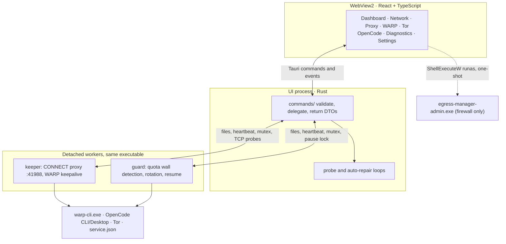
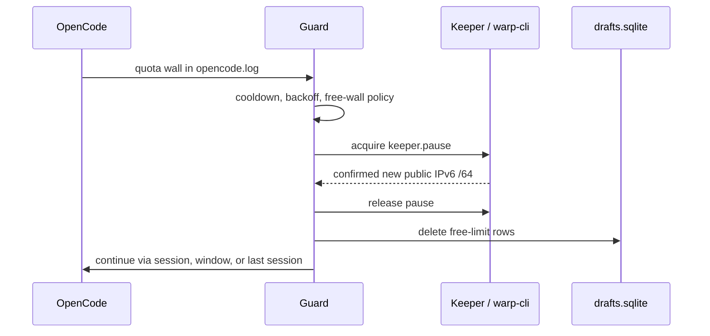

# Architecture



## Rust modules

| Module                   | Role                                                         |
| :----------------------- | :----------------------------------------------------------- |
| `app.rs`                 | Tauri setup, shared UI state, background loops               |
| `commands/`              | Typed command surface, input validation                      |
| `config/`                | Paths, atomic persistence, egress/settings/guard/proxy state |
| `services/networking.rs` | IpHelper adapters, IPv6 helpers, public egress probes        |
| `services/warp.rs`       | warp-cli wrapper, hop, endpoints                             |
| `services/proxy/`        | CONNECT server, relay, edge failover, SOCKS5/HTTP clients    |
| `services/tor.rs`        | Portable Tor lifecycle, checksum download, circuit rotation  |
| `services/opencode.rs`   | Detection, service.json wiring, DB maintenance, resume       |
| `services/firewall.rs`   | netsh kill-switch for the admin binary                       |
| `services/scheduler.rs`  | Scheduled tasks via generated XML                            |
| `services/install.rs`    | Shims, PATH, install/uninstall                               |
| `services/lane.rs`       | Ephemeral proxy for a single launched OpenCode process       |
| `services/worker.rs`     | Keeper and guard loops                                       |
| `services/secrets.rs`    | DPAPI credential store                                       |
| `platform.rs`, `errors/` | Win32 wrappers, typed errors, redaction                      |

## Frontend structure

```text
src/app          providers, router, shell
src/components   ui.tsx barrel over shadcn primitives, toasts
src/features     dashboard, network, proxy, warp, tor, opencode, diagnostics, settings
src/hooks        TanStack Query state, event bridge, actions
src/lib          Tauri client, formatting, Zod validation
src/services     typed API wrappers
src/store        Zustand toasts
src/types        DTOs matching Rust serialization
```

## Rotation and resume



## State and workers

State lives under `%LOCALAPPDATA%\opencode-egress-manager\` (`egress.json`, `settings.json`,
`credentials.json`, `lane/`, `guard/`, `keeper/`, `logs/`, `bin/`). Writes are atomic and
keep a `.bak`.

Workers run from Scheduled Tasks at logon via `--worker keeper|guard`. Each holds a named
mutex and writes heartbeats. Closing the UI does not stop them. Long operations use pause
files removed on drop.

## Privilege model

UI and workers run as the user. Firewall changes elevate a separate helper with three fixed
subcommands. No PowerShell is used for control operations.
